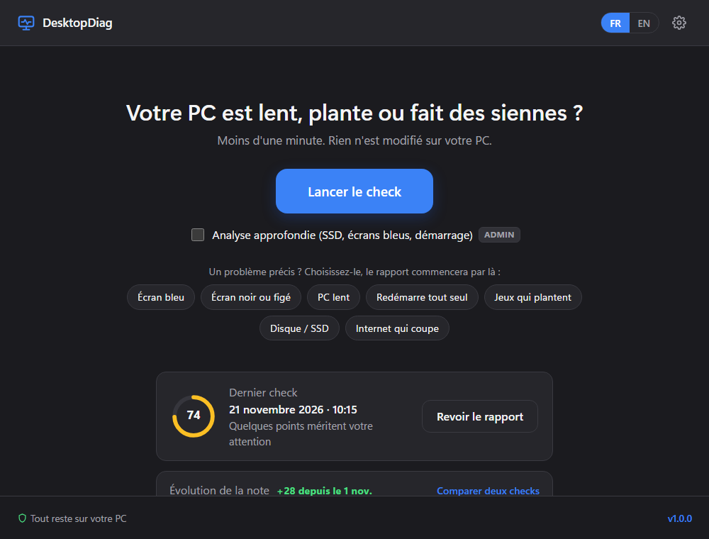
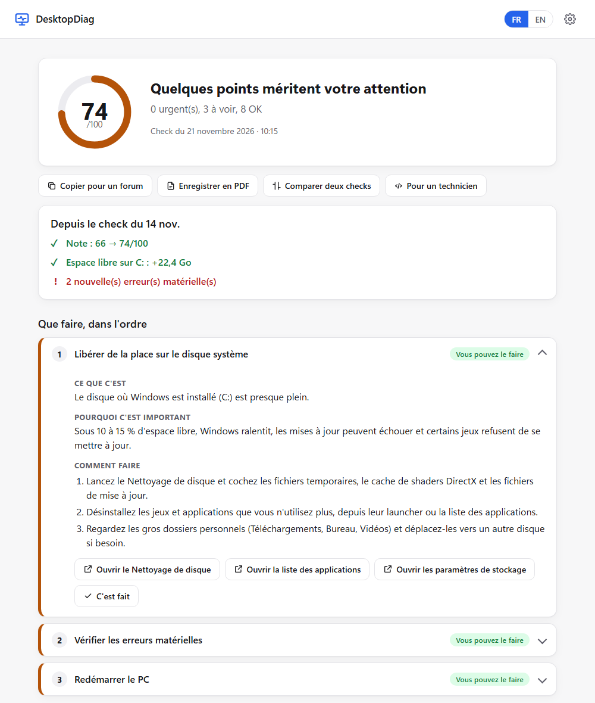

# DesktopDiag

### Ton PC est lent, a des petits bugs, plante... ou tu veux juste faire un petit checking ?

DesktopDiag passe ton Windows au crible et t'explique simplement ce qui ne va pas, et quoi faire.
**Lecture seule**, gratuit et open source, en **français ou en anglais**.

[🇬🇧 English version](README.md)

> **👋 Un projet perso.** DesktopDiag est né comme un outil fait sur mesure pour mon propre PC,
> après des semaines à traquer des freezes GPU et des écrans bleus, puis il est devenu quelque chose
> que j'ai eu envie de partager. Ce n'est pas un produit commercial, et il est loin d'être terminé.
>
> **N'hésite pas à laisser ton avis !** Tu l'as essayé ? Un bug, un diagnostic à côté de la plaque,
> un contrôle qui manque, ou juste une idée ? [Ouvre une issue](https://github.com/Lykroze9/DesktopDiag/issues)
> ou lance une [discussion](https://github.com/Lykroze9/DesktopDiag/discussions), en français ou en anglais. Chaque retour aide à améliorer DesktopDiag.

## Télécharger l'appli

**[⬇️ Télécharger DesktopDiag.exe](https://github.com/Lykroze9/DesktopDiag/releases/latest/download/DesktopDiag.exe)** · [Notes de version et SHA-256](https://github.com/Lykroze9/DesktopDiag/releases/latest)

Un seul fichier portable (environ 1 Mo) : tu le télécharges, tu double-cliques, c'est parti. Rien à
installer, pas de compte.

<p>
  
  
</p>

- **Un clic**, moins d'une minute : une note sur 100 et chaque domaine expliqué simplement
  (OK / À voir / Urgent).
- **Conseils en 3 parties** (ce que c'est, pourquoi c'est important, comment faire), un bouton
  **Ouvrir pour moi** vers le bon écran de Windows, et **C'est fait**, vérifié au check suivant.
- **Analyse approfondie** en option avec les droits admin : santé des SSD (SMART), analyse des
  écrans bleus avec le pilote en cause probable, durée réelle du démarrage, vérification du disque.
- Mode symptôme (« écran bleu », « PC lent »…), courbe de la note, comparaison de deux checks,
  **PDF**, copie pour un forum, vue technicien, 4 thèmes, taille du texte, **français ou anglais**.
- **Lecture seule**, pas de compte, pas de télémétrie. Elle vérifie seulement une fois par jour s'il
  existe une nouvelle version sur GitHub (désactivable) ; les mises à jour sont vérifiées par SHA-256.

**Premier lancement :** l'appli n'est pas encore signée, donc Windows SmartScreen peut afficher
*« Windows a protégé votre ordinateur »*. Clique sur **Informations complémentaires**, puis sur
**Exécuter quand même**. Tu peux comparer le fichier avec le SHA-256 de la release, et tout le code
est dans [`app/`](app/). Il faut Windows 10 22H2 ou 11 (x64) et le composant Microsoft Edge WebView2,
déjà présent sur Windows 11 et sur les Windows 10 à jour.

## Ce qui est vérifié

| Domaine | Détails |
|---|---|
| Stabilité | Écrans bleus (code d'arrêt + paramètres), arrêts inattendus, fichiers de vidage, indice de fiabilité Windows |
| Carte graphique | Réinitialisations du pilote (TDR), erreurs NVIDIA/AMD/Intel, version et âge du pilote, outils d'overclocking au démarrage |
| Stockage | Espace libre, santé des disques, usure/température/erreurs SSD (SMART via smartctl), erreurs disque rattachées au bon disque (USB ou SSD système) |
| Matériel | Erreurs matérielles WHEA (CPU, RAM, PCIe), résultat du test mémoire Windows, erreurs TPM, périphériques en erreur (code 10/43...) |
| Sécurité | Antivirus, pare-feu, dernière mise à jour Windows réussie et échecs récents, redémarrage en attente, UAC, Secure Boot |
| Performances | Vrai % CPU (mesuré, pas cumulé), RAM et mémoire engagée, processus les plus gourmands |
| Démarrage | Durée du BIOS à chaque démarrage, démarrage rapide ; avec l'analyse approfondie : durée totale du démarrage et ce qui l'a ralenti (appli, pilote, service) |
| Chauffe | Bridage du processeur par le BIOS (chaleur ou limite de puissance), limitation en direct, zones thermiques si le PC les expose |
| Réseau | Signal Wi-Fi, ping de la box, temps de réponse DNS, coupures Wi-Fi et Ethernet |
| Batterie | Portables : santé (capacité actuelle par rapport à neuve) et cycles de charge |
| Entretien | Programmes au démarrage, dossiers temporaires, durée depuis le dernier redémarrage, taille de la mémoire virtuelle et du fichier d'hibernation |
| Historique | Chaque check est sauvegardé en local et comparé au précédent : nouveaux plantages, espace perdu, mises à jour de pilote/BIOS, nouveaux programmes au démarrage |

Ce qui le rend différent :

- il regarde les problèmes qu'on rencontre vraiment : plantages du pilote graphique, usure des SSD,
  pilote responsable d'un écran bleu, et « est-ce que ça va mieux depuis la semaine dernière ? » ;
- le check principal n'a **pas besoin des droits admin** ; l'analyse approfondie en option ajoute
  SMART, l'analyse des écrans bleus et un scan du système de fichiers en lecture seule ;
- il est **en lecture seule** : il conseille, c'est toi qui décides ;
- le même PC a toujours la même note : elle vient de règles écrites
  ([rules.json](https://github.com/Lykroze9/DesktopDiag-Skill/blob/main/skills/desktopdiag/rules/rules.json), seuils dans
  [rules/README.md](https://github.com/Lykroze9/DesktopDiag-Skill/blob/main/skills/desktopdiag/rules/README.md)) ;
- il tourne avec ce que Windows 10 et 11 ont déjà (PowerShell 5.1, .NET Framework, WebView2).

## Outils optionnels

L'analyse approfondie peut utiliser deux outils gratuits. L'appli propose de les installer s'ils
manquent.

- [smartmontools](https://www.smartmontools.org/) (`winget install smartmontools.smartmontools`) pour les données SMART détaillées des SSD/disques durs.
- WinDbg (`winget install Microsoft.WinDbg`) pour identifier le pilote responsable d'un écran bleu. La première analyse télécharge les symboles publics de Microsoft.

## Confidentialité

Tout tourne en local. Rien n'est envoyé (sauf le téléchargement des symboles Microsoft si tu acceptes
l'analyse des écrans bleus). Les numéros de série des disques sont hachés. Les checks sont stockés dans
`%LOCALAPPDATA%\DesktopDiag\history`. Le rapport « copier pour un forum » ne contient ni ton nom
d'utilisateur, ni le nom du PC, ni de chemins de fichiers.

## Avertissement

DesktopDiag lit des informations système et donne des conseils. Il ne remplace pas un technicien.
Les interventions matérielles (mise à jour du BIOS, changement de pâte thermique, remplacement de
pièces) restent ta décision et ta responsabilité.

---

## Pour les utilisateurs de Claude Code : le skill

DesktopDiag existe aussi en **skill pour [Claude Code](https://claude.com/claude-code)** : tu parles à
Claude au lieu de cliquer (« fais un check du PC », « écran noir en jeu »). Mêmes contrôles, mêmes
règles, avec en plus des explications sur mesure, des réponses à tes questions et des checks de suivi
programmés.

**📂 [DesktopDiag-Skill sur GitHub](https://github.com/Lykroze9/DesktopDiag-Skill)** (installation, utilisation, scripts et règles).
## Développement

```powershell
git clone --recursive https://github.com/Lykroze9/DesktopDiag
```

L'appli est en C# 5, compilée avec le compilateur du .NET Framework 4.8 déjà présent sur Windows, avec
une interface HTML/CSS dans WebView2. Les contrôles PowerShell et les règles viennent de
[DesktopDiag-Skill](https://github.com/Lykroze9/DesktopDiag-Skill), inclus comme sous-module git
`skill` (une seule source : l'appli et le skill font toujours les mêmes contrôles). Mets les trois
fichiers du SDK WebView2 (`Microsoft.Web.WebView2.Core.dll`, `Microsoft.Web.WebView2.WinForms.dll`,
`WebView2Loader.dll` en x64, tirés du paquet NuGet `Microsoft.Web.WebView2` 1.0.4258.31) dans `app\lib`,
puis lance `app\build.ps1`. GitHub Actions compile l'appli à chaque push. Les nouveautés sont dans
[CHANGELOG.md](CHANGELOG.md).
## Licence

MIT
