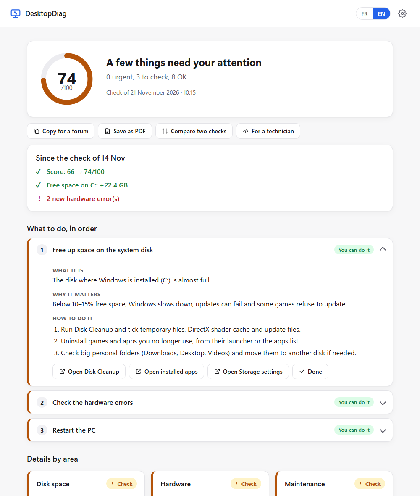

# DesktopDiag

### Is your PC slow, glitchy, crashing... or do you just want a quick checkup?

DesktopDiag scans your Windows PC and tells you in plain words what's wrong, and what to do about it.

> **👋 A personal side project.** DesktopDiag started as a custom tool I built for my own PC, after
> chasing GPU freezes and blue screens, and grew into a skill I wanted to share. It is not a
> commercial product and it is far from finished.
>
> **Your feedback is very welcome!** Tried it? Found a bug, a wrong diagnosis, a missing check, or
> just have an idea? Please [open an issue](https://github.com/Lykroze9/DesktopDiag/issues) or start a
> [discussion](https://github.com/Lykroze9/DesktopDiag/discussions), in English or French. Every comment helps make the skill better.

**Read-only Windows PC health check for Claude Code.** Ask "check my PC" or describe a problem
("my screen goes black in games", "random reboots") and Claude collects the data, explains it in
plain language, scores your PC and tells you what to do next. Reports in **English or French**.

[🇫🇷 Version française](README.fr.md)

## Without Claude: the Windows app

Don't use Claude? Download **DesktopDiag.exe**: one portable file (about 1 MB), nothing to install.

**[⬇️ Download DesktopDiag.exe](https://github.com/Lykroze9/DesktopDiag/releases/latest/download/DesktopDiag.exe)** · [Release notes and SHA-256](https://github.com/Lykroze9/DesktopDiag/releases/latest)

<p>
  
  
</p>

- **One click**, under a minute: score out of 100, every area in plain words (OK / Check / Urgent).
- **Advice in 3 parts** (what it is, why it matters, how to do it), an **Open it for me** button for
  the right Windows screen, and **Done** tracking that the next check verifies.
- **Optional deep scan** with admin rights: SSD health (SMART), blue screen analysis with the likely
  culprit driver, real startup time, file system check.
- Symptom mode ("blue screen", "slow PC"...), score history, compare two checks, **PDF**, copy for a
  forum, technician view, 4 themes, text size, **English or French**.
- Same checks and rules as the Claude skill. **Read-only**, no account, no telemetry. It only checks
  GitHub once a day for a new version (can be turned off); updates are verified with SHA-256.

**First launch:** the app is not code-signed yet, so Windows SmartScreen may say *"Windows protected
your PC"*. Click **More info**, then **Run anyway**. You can check the file against the SHA-256 in the
release, and the whole source is in [`app/`](app/). Needs Windows 10 22H2 or 11 (x64) and the
Microsoft Edge WebView2 runtime, already present on Windows 11 and up-to-date Windows 10.

## What it checks

| Area | Details |
|---|---|
| Stability | Blue screens (stop code + parameters), unexpected shutdowns, crash dumps, Windows reliability index |
| Graphics | Display driver resets (TDR), NVIDIA/AMD/Intel driver errors, driver version and age, overclocking tools at startup |
| Storage | Free space, disk health, SSD wear/temperature/errors (SMART via smartctl), disk errors mapped to the right drive (USB vs system SSD) |
| Hardware | WHEA hardware errors (CPU, RAM, PCIe), Windows Memory Diagnostic result, TPM errors, devices in error (code 10/43...) |
| Security | Antivirus status, firewall profiles, last successful Windows Update and recent failures, pending reboot, UAC, Secure Boot |
| Performance | Real CPU % (sampled, not cumulative), RAM and commit usage, top processes |
| Boot time | Firmware/BIOS time of each boot, Fast Startup; with admin: total boot time and what slowed each boot down (app, driver, service) |
| Heat | CPU throttling by firmware (heat or power limits), live performance limit, thermal zones when the PC exposes them |
| Network | Wi-Fi signal, router ping, DNS response time, Wi-Fi and Ethernet drops |
| Battery | Laptops: health (current vs original capacity) and charge cycles |
| Maintenance | Startup entries, temp folders, uptime, page file and hibernation file size |
| History | Every check is saved locally and compared with the previous one: new crashes since last time, space lost, driver/BIOS updates, startup entries added |
| Follow-up | After each report, Claude proposes the next check sized to what it found (in 2-4 days after a fix, weekly while problems settle, monthly otherwise) and schedules it on your OK with the Claude desktop app's local scheduled tasks |

## Why another one?

Existing Windows diagnostic skills/MCP servers skip the problems people actually hit: GPU driver
resets, NVMe wear, BSOD culprit drivers, and "did it get better since last week?". DesktopDiag
also:

- runs on the **built-in Windows PowerShell 5.1** (no PowerShell 7, Node or Python needed), Windows 10 and 11;
- needs **no admin** for the main check; an optional admin step adds SMART, dump analysis and a read-only file system scan;
- is **read-only**: fixes are proposed with risk levels and run only after your explicit OK;
- documents real-world traps (inflated crash counts in the Application log, `chkdsk` access denied, vendor utilities reinstalling drivers, sandboxed registry writes...);
- has a **share mode** that strips user name, computer name and paths for forum posts.

## Install

### As a Claude Code plugin

```
/plugin marketplace add Lykroze9/DesktopDiag
/plugin install desktopdiag@desktopdiag
```

### As a standalone skill

Copy `skills/desktopdiag` to `%USERPROFILE%\.claude\skills\desktopdiag` (all projects) or to
`.claude\skills\desktopdiag` in a project.

## Use

Just talk to Claude Code:

- "Check my PC" / "Is my PC healthy?"
- "My screen goes black for a few seconds when I play"
- "My PC rebooted by itself twice this week"
- "Is my SSD OK?"
- "Do a full check" (proposes the admin deep scan)
- "Make a shareable report for a forum"
- "Schedule a check every month" / "Check again in 4 days"

You can also run the collector yourself:

```powershell
powershell -NoProfile -ExecutionPolicy Bypass -File skills\desktopdiag\scripts\collect.ps1
powershell -NoProfile -ExecutionPolicy Bypass -File skills\desktopdiag\scripts\compare.ps1
```

Add `-Summary` to `collect.ps1` for a compact digest (about 10x smaller than the full snapshot).
Claude uses it by default, so each check costs far fewer tokens.

Snapshots are stored in `%LOCALAPPDATA%\DesktopDiag\history`.

## Score

The score and the area levels come from `skills/desktopdiag/rules/rules.json`, applied by
`scripts/score.ps1`: the same PC always gets the same score, and Claude adds the explanations.
Thresholds are documented in [rules/README.md](skills/desktopdiag/rules/README.md).

## Development

```powershell
powershell -NoProfile -ExecutionPolicy Bypass -File tests\run-tests.ps1 -Live
```

Tests use synthetic snapshots (`tests/fixtures.ps1`, no real machine data) and run on every push
with GitHub Actions, together with PSScriptAnalyzer. See [CHANGELOG.md](CHANGELOG.md) for what changed.

The Windows app (`app/`) is C# 5 compiled with the .NET Framework 4.8 compiler already on Windows,
with an HTML/CSS interface in WebView2. Put the three WebView2 SDK files (`Microsoft.Web.WebView2.Core.dll`,
`Microsoft.Web.WebView2.WinForms.dll`, `WebView2Loader.dll` for x64, from the NuGet package
`Microsoft.Web.WebView2` 1.0.4258.31) in `app\lib`, then run `app\build.ps1`. It embeds the skill's
scripts and rules, so the app and the skill always share the same checks.

## Optional tools

- [smartmontools](https://www.smartmontools.org/) (`winget install smartmontools.smartmontools`) for detailed SSD/HDD SMART data.
- WinDbg (`winget install Microsoft.WinDbg`) to identify the driver behind a blue screen. The first analysis downloads public symbols from Microsoft.

## Privacy

Everything runs locally. Nothing is uploaded (except Microsoft symbol downloads if you accept dump
analysis). Disk serial numbers are hashed. Use share mode before posting a report anywhere.

## Disclaimer

DesktopDiag reads system information and gives advice. It does not replace a technician. Hardware
interventions (BIOS updates, repasting, part replacement) are your decision and responsibility.

## License

MIT
