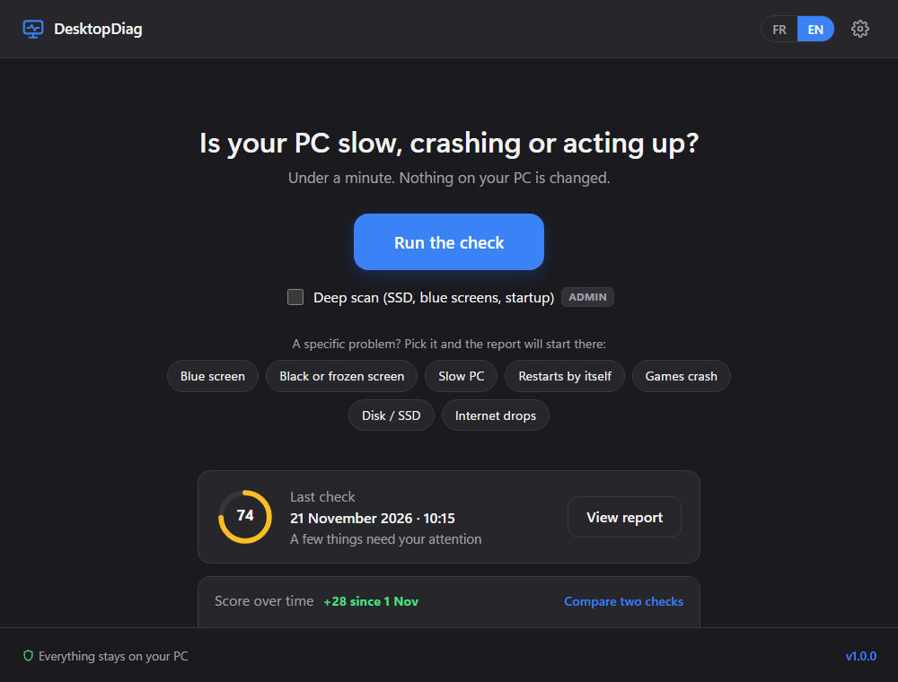

# DesktopDiag

### Is your PC slow, glitchy, crashing... or do you just want a quick checkup?

DesktopDiag scans your Windows PC and tells you in plain words what's wrong, and what to do about it.
**Read-only**, free and open source, in **English or French**.

[🇫🇷 Version française](README.fr.md)

> **👋 A personal side project.** DesktopDiag started as a custom tool I built for my own PC, after
> chasing GPU freezes and blue screens, and grew into something I wanted to share. It is not a
> commercial product and it is far from finished.
>
> **Your feedback is very welcome!** Tried it? Found a bug, a wrong diagnosis, a missing check, or
> just have an idea? Please [open an issue](https://github.com/Lykroze9/DesktopDiag/issues) or start a
> [discussion](https://github.com/Lykroze9/DesktopDiag/discussions), in English or French. Every comment helps make DesktopDiag better.

## Download the app

**[⬇️ Download DesktopDiag.exe](https://github.com/Lykroze9/DesktopDiag/releases/latest/download/DesktopDiag.exe)** · [Release notes and SHA-256](https://github.com/Lykroze9/DesktopDiag/releases/latest)

One portable file (about 1 MB): download it, double-click it, done. Nothing to install, no account.

<p>
  
  
</p>

- **One click**, under a minute: score out of 100, every area in plain words (OK / Check / Urgent).
- **Advice in 3 parts** (what it is, why it matters, how to do it), an **Open it for me** button for
  the right Windows screen, and **Done** tracking that the next check verifies.
- **Optional deep scan** with admin rights: SSD health (SMART), blue screen analysis with the likely
  culprit driver, real startup time, file system check.
- Symptom mode ("blue screen", "slow PC"...), score history, compare two checks, **PDF**, copy for a
  forum, technician view, 4 themes, text size, **English or French**.
- **Read-only**, no account, no telemetry. It only checks GitHub once a day for a new version (can be
  turned off); updates are verified with SHA-256.

**First launch:** the app is not code-signed yet, so Windows SmartScreen may say *"Windows protected
your PC"*. Click **More info**, then **Run anyway**. You can check the file against the SHA-256 in the
release, and the whole source is in [`app/`](app/). Needs Windows 10 22H2 or 11 (x64) and the
Microsoft Edge WebView2 runtime, already present on Windows 11 and up-to-date Windows 10.

## What it checks

| Area | Details |
|---|---|
| Stability | Blue screens (stop code + parameters), unexpected shutdowns, crash dumps, Windows reliability index |
| Graphics | Display driver resets (TDR), NVIDIA/AMD/Intel driver errors, driver version and age, overclocking tools at startup |
| Storage | Free space, disk health, SSD wear/temperature/errors (SMART via smartctl), disk errors mapped to the right drive (USB vs system SSD) |
| Hardware | WHEA hardware errors (CPU, RAM, PCIe), Windows Memory Diagnostic result, TPM errors, devices in error (code 10/43...) |
| Security | Antivirus status, firewall profiles, last successful Windows Update and recent failures, pending reboot, UAC, Secure Boot |
| Performance | Real CPU % (sampled, not cumulative), RAM and commit usage, top processes |
| Boot time | Firmware/BIOS time of each boot, Fast Startup; with the deep scan: total boot time and what slowed each boot down (app, driver, service) |
| Heat | CPU throttling by firmware (heat or power limits), live performance limit, thermal zones when the PC exposes them |
| Network | Wi-Fi signal, router ping, DNS response time, Wi-Fi and Ethernet drops |
| Battery | Laptops: health (current vs original capacity) and charge cycles |
| Maintenance | Startup entries, temp folders, uptime, page file and hibernation file size |
| History | Every check is saved locally and compared with the previous one: new crashes since last time, space lost, driver/BIOS updates, startup entries added |

What makes it different:

- it looks at the problems people actually hit: GPU driver resets, SSD wear, the driver behind a blue
  screen, and "did it get better since last week?";
- the main check needs **no admin rights**; the optional deep scan adds SMART, crash dump analysis and
  a read-only file system scan;
- it is **read-only**: it gives advice, you decide what to do;
- the same PC always gets the same score: the score comes from written rules
  ([rules.json](https://github.com/Lykroze9/DesktopDiag-Skill/blob/main/skills/desktopdiag/rules/rules.json), thresholds in
  [rules/README.md](https://github.com/Lykroze9/DesktopDiag-Skill/blob/main/skills/desktopdiag/rules/README.md));
- it runs on what Windows 10 and 11 already have (PowerShell 5.1, .NET Framework, WebView2).

## Optional tools

The deep scan can use two free tools. The app offers to install them when they are missing.

- [smartmontools](https://www.smartmontools.org/) (`winget install smartmontools.smartmontools`) for detailed SSD/HDD SMART data.
- WinDbg (`winget install Microsoft.WinDbg`) to identify the driver behind a blue screen. The first analysis downloads public symbols from Microsoft.

## Privacy

Everything runs locally. Nothing is uploaded (except Microsoft symbol downloads if you accept blue
screen analysis). Disk serial numbers are hashed. Checks are stored in
`%LOCALAPPDATA%\DesktopDiag\history`. The "copy for a forum" report contains no user name, computer
name or file paths.

## Disclaimer

DesktopDiag reads system information and gives advice. It does not replace a technician. Hardware
interventions (BIOS updates, repasting, part replacement) are your decision and responsibility.

---

## For Claude Code users: the skill

DesktopDiag also exists as a **skill for [Claude Code](https://claude.com/claude-code)**: you talk to
Claude instead of clicking ("check my PC", "my screen goes black in games"). Same checks, same rules,
plus tailored explanations, answers to your questions and scheduled follow-up checks.

**📂 [DesktopDiag-Skill on GitHub](https://github.com/Lykroze9/DesktopDiag-Skill)** (install, usage, scripts and rules).
## Development

```powershell
git clone --recursive https://github.com/Lykroze9/DesktopDiag
```

The app is C# 5 compiled with the .NET Framework 4.8 compiler already on Windows, with an HTML/CSS
interface in WebView2. The PowerShell checks and rules come from
[DesktopDiag-Skill](https://github.com/Lykroze9/DesktopDiag-Skill), included as the `skill` git
submodule (single source: the app and the skill always run the same checks). Put the three WebView2 SDK
files (`Microsoft.Web.WebView2.Core.dll`, `Microsoft.Web.WebView2.WinForms.dll`, `WebView2Loader.dll`
for x64, from the NuGet package `Microsoft.Web.WebView2` 1.0.4258.31) in `app\lib`, then run
`app\build.ps1`. GitHub Actions builds the app on every push. See [CHANGELOG.md](CHANGELOG.md) for what changed.
## License

MIT
